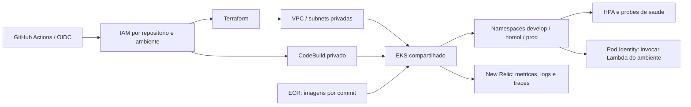

# fiap-k8s

Plataforma AWS/Kubernetes do projeto: rede privada, EKS, executores de deploy, identidades IAM, observabilidade e operações de reconstrução/desmontagem.

📚 **[Documentação principal — fiap-docs](https://github.com/FIAP-GRUPO05/fiap-docs)**

## Tecnologias e requisitos

Terraform 1.13+, Python 3.12, AWS CLI, GitHub CLI, Trivy no PATH (ou `--trivy <caminho>`), Docker, Amazon EKS, CodeBuild, ECR e New Relic. O provisionamento é na conta `456687462806`, região São Paulo (`sa-east-1`). O operador de bootstrap precisa de identidade AWS administrativa autenticada; integrantes não precisam compartilhar credenciais para executar a CI.

## Arquitetura deste componente



## Validar localmente

Na raiz deste repositório:

```powershell
terraform -chdir=infra/bootstrap init -backend=false -input=false
terraform -chdir=infra/bootstrap validate
terraform -chdir=infra/platform init -backend=false -input=false
terraform -chdir=infra/platform validate
python -m unittest discover -s .github/scripts -p 'test_*.py' -v
```

A validação não cria recursos. As raízes ativas são `infra/bootstrap`, `infra/platform` e `infra/observability`; as definições antigas de `infra/prod` não são a instalação atual.

## Deploy e ambientes

O fluxo é `feature/* → develop → release/vX.Y.Z → prod → main`. Após o push da feature e o sucesso da CI, o PR é aberto automaticamente; os merges são manuais. Os próximos PRs são gerados após a promoção aprovada. `develop`, `release/*` e `prod` publicam no ambiente correspondente quando a infraestrutura está `active`; `prod → main` apenas consolida a versão.

Em `destroyed`/`destroying`, deploys e promoções ficam bloqueados. Em `maintenance`, a CI permite validar e promover código, mantendo os deploys bloqueados. O bootstrap administrativo usa AWS CLI; a operação diária do CI usa OIDC e não exige credenciais AWS de cada integrante.

O primeiro provisionamento é administrativo e respeita a dependência plataforma → banco → Lambda/Gateway → aplicação. Depois disso, o workflow aplica a plataforma em `prod` e configura New Relic. A publicação da aplicação usa CodeBuild, pois o endpoint Kubernetes é privado.

## Reconstruir após destroy

A reconstrução foi validada em 28/10/2026: EKS, RDS, Lambdas e APIs dos três ambientes estão ativos; a CI permanece em `maintenance` durante a integração dos PRs. Esse modo bloqueia deploys, mas não desliga recursos nem interrompe cobranças AWS. Para conferir a sessão, sem alterar a conta:

```powershell
aws login --profile twm-admin
python tools/restore_infra.py --stage status --profile twm-admin-terraform
```

O perfil `twm-admin-terraform` deve usar `credential_process` para exportar a sessão temporária do `twm-admin`. Após uma desmontagem, com os quatro repositórios lado a lado, configure um remetente SES e um destinatário de teste autorizados:

```powershell
python tools/restore_infra.py --stage all --execute --sender 'remetente@dominio.com' --test-recipient 'teste@dominio.com'
```

O script para se o remetente SES ainda não estiver verificado, importa IAM/OIDC preservados, reconcilia dashboards e alertas existentes do New Relic para evitar duplicação, restaura segredos ainda recuperáveis, recusa planos com exclusões/substituições e mantém a CI em `maintenance`. A reconstrução exige reconciliação dos estados anteriores; mensagens de falha devem ser resolvidas antes de retomar a etapa. Consulte `--help` para executar uma etapa individual. O script não substitui a revisão dos planos e só altera recursos com `--execute`.

Não repita `--stage all` sobre a instalação já reconstruída: confira o estado e retome somente a etapa pendente. O bootstrap inicial desabilita temporariamente o proxy do backend, que já está habilitado na instalação concluída.

Depois de reconstruir, ele atualiza `FIAP_RUNTIME_CONFIG` e os endpoints do monitor de uptime. A ativação é uma etapa explícita: `--stage activate --execute`, com os mesmos remetente/destinatário, após os regressivos reais. Para desligar, use `feature/destroy-infra-aws` → `ALL`, com as aprovações exigidas; o relatório inclui as Lambdas de e-mail e distingue recursos removidos dos retidos.

## APIs e observabilidade

Este componente não tem Swagger próprio. Consulte o [Swagger e as URLs da aplicação](https://github.com/FIAP-GRUPO05/fiap-application#api-e-urls-dos-ambientes). Os dashboards New Relic são obtidos em `terraform -chdir=infra/observability output dashboard_urls` após provisionamento/reconciliação do respectivo state. Regressivos reais verificam saúde, APM, eventos de OS, logs correlacionados e uptime; com a AWS desligada, esses checks ficam pendentes e não representam aprovação do deploy.

## Membros da equipe

<table>
  <tr>
    <td align="center" width="160">
      <a href="https://www.linkedin.com/in/wesslima/" title="Wesley Lima">
        <br>
        <sub><b>Wesley Lima</b></sub>
      </a><br><sub>Backend Engineer</sub>
    </td>
    <td align="center" width="160">
      <a href="https://www.linkedin.com/in/tim-morgenstern-4581911b1/" title="Tim Morgenstern">
        <br>
        <sub><b>Tim Morgenstern</b></sub>
      </a><br><sub>Backend Engineer</sub>
    </td>
    <td align="center" width="160">
      <a href="https://www.linkedin.com/in/matheus-pitas-baptista/" title="Matheus Pitas Baptista">
        <br>
        <sub><b>Matheus Pitas Baptista</b></sub>
      </a><br><sub>Backend Engineer</sub>
    </td>
  </tr>
</table>
